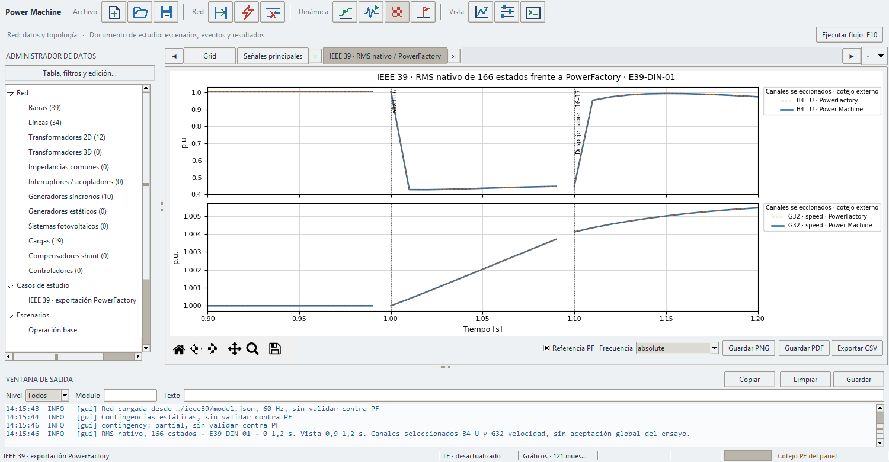
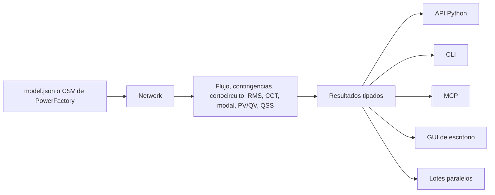
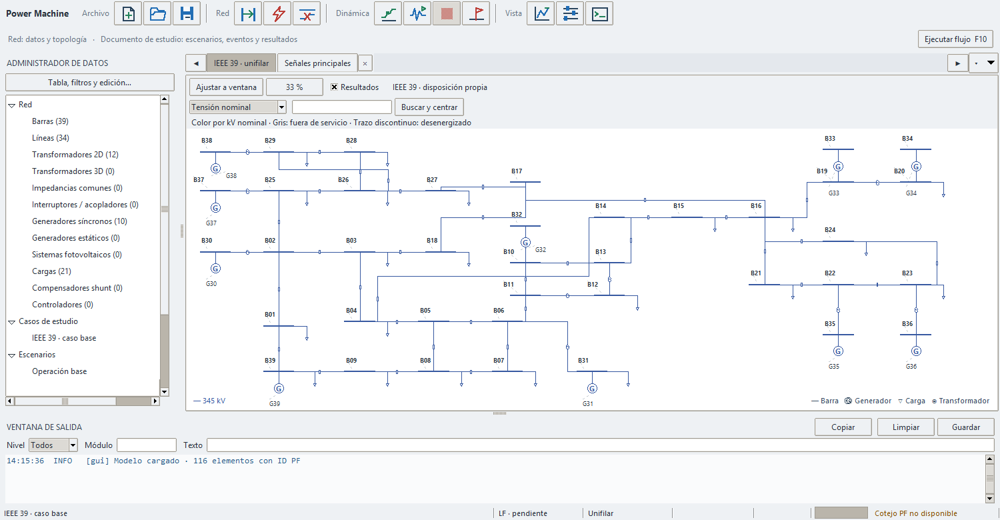
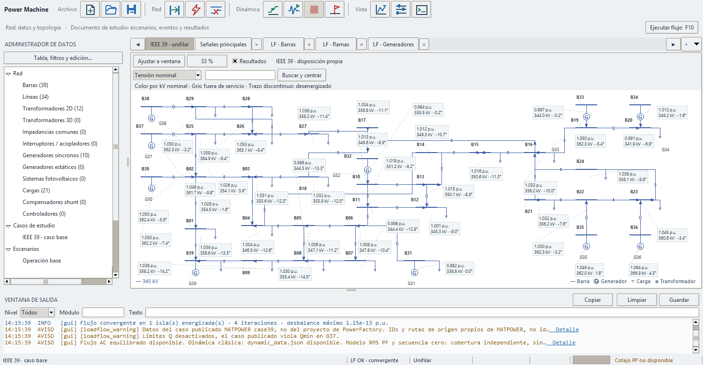
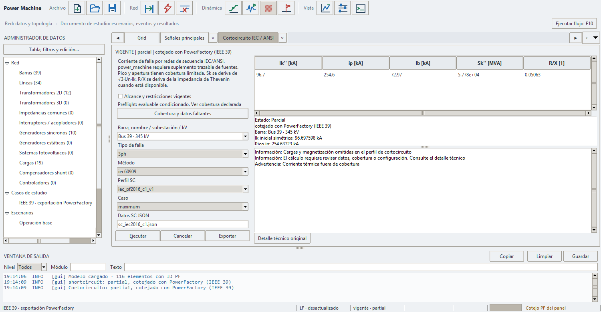
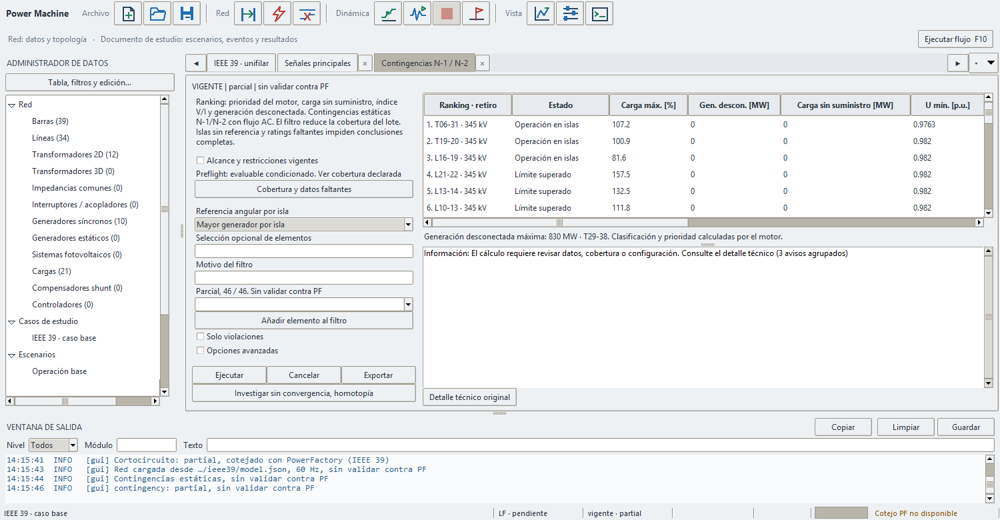

# Power Machine

> Estudios de sistemas eléctricos de potencia en Python, con GUI de escritorio y herramientas MCP para agentes de IA

Versión preliminar **0.1.0**. [English version](README.md).

[](https://github.com/BLITZmain2048/power_machine/actions/workflows/tests.yml)




*RMS nativo IEEE 39, 166 estados, paso de 1 ms y ventana de comparación de 1.2 s. La gráfica muestra dos canales que cumplen sus criterios publicados.*

## Aspectos destacados

- Importa exportaciones CSV de PowerFactory y conserva identidad estable y procedencia de cada elemento.
- Ejecuta flujo AC, contingencias N-1 y N-2, cortocircuito IEC 60909 por perfil, RMS, CCT, modal, PV/QV y estudios cuasi-dinámicos.
- Las comparaciones IEEE 39 incluidas muestran errores máximos aproximados de 1.215e-9 p.u. en tensión de flujo y 2.600e-8 relativo en Ik''. Consulte la [evidencia de validación](docs/validation.md).
- Ejecuta campañas paralelas reproducibles con semillas deterministas, puntos de reanudación y continuación.
- Ofrece un servidor MCP con 23 herramientas, recursos y prompts para agentes, además de API tipada, CLI y GUI de escritorio.
- Usa solo la biblioteca estándar de Python y NumPy en la ruta base, con SciPy disponible como extra opcional de aceleración.

## Instalación

Desde un checkout, instale el paquete base. Los extras son opcionales.

```console
python -m pip install -e .
python -m pip install -e ".[fast]"
python -m pip install -e ".[gui]"
python -m pip install -e ".[tables]"
```

`fast` habilita rutas opcionales de SciPy, `gui` agrega Matplotlib y `tables` agrega pandas. Tkinter lo entrega la instalación de Python en sistemas de escritorio compatibles.

## Recorrido IEEE 39 en diez líneas

El recorrido resuelve el caso base antes de evaluar salidas N-1. Ejecútelo desde la raíz del repositorio después de instalar.

```python
import power_machine as pm
net = pm.load_case("ieee39")
flow = pm.loadflow(net)
assert flow.status == "completed"
print(f"{flow.summary['max_mismatch_mva']:.2e}")
n1 = pm.contingency(net)
cases = n1.cases.to_records()
print(n1.status, len(cases))
worst = n1.rank().to_records()[0]
print(f"{worst['label']} {worst['max_loading_pct']:.2f}")
```

Salida esperada del caso incluido, abreviada:

```text
2.18e-10
partial 56
L21-22 157.72
```

La [guía de API](docs/api.md) explica tablas tipadas y diagnósticos. Los ejemplos incluidos cubren flujo, cortocircuito, contingencias, RMS e importación.

## Cómo funciona



## CLI y MCP

```console
power-machine doctor
power-machine lf ieee39 --json
```

Use `power-machine-mcp` para MCP por stdio. La [configuración MCP](docs/mcp.md) incluye clientes MCP, esquemas de herramientas, recursos, prompts y paginación.

Transcripción corta MCP del recorrido N-1 incluido:

```text
client  load_case {"name_or_path":"ieee39"}
server  network_id: "885bb4f577234a42b605ef5ad1519410", barras: 39, ramas: 46
client  run_loadflow {"network_id":"885bb4f577234a42b605ef5ad1519410"}
server  result_id: "eef60159e4514317b514ee9ca76d3af4", estado: completed, completo: true
client  run_contingency {"network_id":"885bb4f577234a42b605ef5ad1519410","criterion":"N-1","max_cases":100}
server  result_id: "f461d26b39394adfa96378dbba11a63f", estado: partial, evaluadas: 56
client  copy_network {"network_id":"885bb4f577234a42b605ef5ad1519410","label":"alternative"}
server  network_id: "32fa3e9fd0b04683ac6e0aa4c0dc0d68"
client  run_loadflow {"network_id":"32fa3e9fd0b04683ac6e0aa4c0dc0d68"}
server  result_id: "4c46901a3f9c452e9c7cda7262922346", estado: completed, completo: true
client  compare_results {"before_result_id":"eef60159e4514317b514ee9ca76d3af4","after_result_id":"4c46901a3f9c452e9c7cda7262922346"}
server  estado_anterior: completed, estado_posterior: completed
```

## GUI de escritorio

La aplicación distingue visiblemente red, documento de estudio y resultados desactualizados. Ofrece flujo, ranking de contingencias, entrada de cortocircuito, flujos RMS y controles de lotes cuando el perfil del estudio lo permite.

| Red IEEE 39 | Flujo | Cortocircuito | Ranking N-1 |
| --- | --- | --- | --- |
|  |  |  |  |

Consulte [uso y límites de GUI](docs/gui.md). El [recorrido GUI](docs/images/recorrido.gif) reúne estas cinco vistas.

## Lotes paralelos

Los escenarios independientes de flujo y contingencia pueden ejecutarse en un grupo persistente de procesos. Las entradas, semillas, puntos de reanudación, cancelación y fallos por escenario son explícitos. Cada trabajador prepara su propia instantánea de red y limita los hilos BLAS. Consulte [campañas por lotes](docs/batch.md).

## Capacidades

| Estudio o interfaz | Estado actual | Alcance |
| --- | --- | --- |
| Flujo AC | Implementado | Tablas tipadas, diagnósticos de islas, ruta densa y ruta dispersa opcional |
| N-1 y N-2 | Implementado | Salidas explícitas, política declarada de referencia por isla, cobertura incompleta visible |
| Cortocircuito | Parcial | Datos fuente explícitos y perfiles definidos |
| RMS, CCT, QSS | Parcial | Requieren perfiles y datos dinámicos, con alcances nativo y clásico separados |
| PV, QV, sensibilidades | Implementado | Requieren entradas explícitas de estudio |
| Importación CSV | Parcial | Importa solo campos exportados documentados, nunca datos eléctricos inferidos |
| GUI, CLI, MCP, lotes | Implementado | La GUI sigue en español en esta versión |

## Evidencia de comparación IEEE 39

| Estudio y perfil | Evidencia | Resultado publicado |
| --- | --- | --- |
| Flujo AC | Comparación IEEE 39 incluida de PowerFactory | 39 barras, 46 ramas, 10 generadores. Errores máximos: 1.215e-9 p.u. en tensión, 4.237e-7 grados y 4.205e-6 Mvar en flujo reactivo de rama |
| Edición de red | No hay exportación incluida | Sin comparación |
| Cortocircuito trifásico `iec_pf2016_c1_v1` | Comparación incluida de 39 barras | Errores relativos máximos: 2.600e-8 Ik'', 2.587e-8 ip y 7.176e-8 Ib. Pasan 102 contribuciones por magnitud y 39 residuos KCL |
| RMS clásico IEEE 39 | Paridad interna y balance analítico | Sin comparación con PowerFactory. Es un modelo de 20 estados distinto del RMS nativo |
| RMS nativo IEEE 39, 166 estados | Tres comparaciones incluidas hasta 1.2 s | Evidencia parcial: 26/29, 26/29 y 27/29 canales cumplen su criterio máximo publicado en E39-DIN-01/02/03 |
| Resolución RMS y casos analíticos | Comprobaciones h, h/2, h/4 y casos cerrados | Pasan las comprobaciones declaradas en intervalos suaves y siete casos analíticos. No es una afirmación de orden global a través de eventos |

Ejecute `python -m validation` para reproducir el informe incluido. Consulte [validación](docs/validation.md).

## Mediciones de rendimiento

Las mediciones limpias del 18 de noviembre de 2026 usaron Python 3.10.6, NumPy 2.2.6, un hilo BLAS y cinco muestras tras verificar una CPU bajo 15% de uso.

Como ejemplos absolutos en esa configuración, la campaña N-1 completa IEEE 39 demoró 170.59 ms y el barrido de cortocircuito de 39 barras demoró 26.66 ms.

| Carga | Mediana |
| --- | ---: |
| Flujo IEEE 39 en caliente | 2.76 ms |
| N-1 IEEE 39, política de referencia `none` | 170.59 ms |
| Barrido de cortocircuito IEEE 39 en 39 barras | 26.66 ms |
| Flujo sintético de 200, 1,000, 2,000 barras | 21.77 ms, 645.81 ms, 3.91 s |

### Mediciones Linux con SciPy

Las [muestras Linux del banco](docs/benchmarks/linux_2026-11-18.json) se registraron con `python benchmarks/run_benchmarks.py --study all --backend both --repeats 5` en Linux x86_64, Intel Xeon a 2,10 GHz, 2 vCPU, Python 3.13.18, NumPy 2.5.3 y SciPy 1.18.1. El banco registra un calentamiento fuera de cinco muestras y excluye preparación y compilación.

| Carga | Denso | Disperso |
| --- | ---: | ---: |
| Flujo IEEE 39 | 3,1 ms | 6,9 ms |
| N-1 IEEE 39 | 0,154 s | 0,177 s |
| Barrido de cortocircuito IEEE 39 en 39 barras | 19,1 ms | 19,6 ms |
| Flujo sintético de 200 / 1.000 / 2.000 / 5.000 / 10.000 barras | 20,6 ms / 0,690 s / 4,010 s / no medido / no medido | 17,2 ms / 0,067 s / 0,125 s / 0,323 s / 0,618 s |

Todas las corridas de flujo completadas convergieron. Las corridas dispersas de 5.000 y 10.000 barras usaron tres iteraciones. Son mediciones de otra máquina y no se comparan con los valores Windows anteriores.

[Rendimiento](docs/performance.md) registra el protocolo y las mediciones.

## Límites

- La evidencia de comparación IEEE 39 es específica de cada estudio. La edición de red no tiene comparación incluida y el RMS nativo conserva canales incompletos o fuera de criterio.
- Los CSV importados deben contener la información eléctrica, de secuencias, controles y datos dinámicos exigidos por el estudio. Los datos ausentes siguen ausentes.
- Cortocircuito, RMS y CCT se limitan a sus datos fuente y perfiles declarados.
- El ranking N-1 informa restricciones y resultados topológicos calculados. No establece factibilidad operativa, coordinación de protecciones, respuesta de frecuencia ni reservas.
- Los tiempos son mediciones de la configuración indicada y no comparaciones con otro producto.

PowerFactory es una marca de su titular. Este proyecto no está afiliado ni cuenta con el respaldo de su titular.

## Estructura del repositorio

- `power_machine/` — paquete, API pública, CLI, servidor MCP, GUI y caso IEEE 39 incluido
- `docs/` — documentación en inglés de uso, formato, evidencia y rendimiento
- `examples/` — ejemplos Python ejecutables
- `tests/` — suite pytest
- `validation/` — comando reproducible de evidencia IEEE 39 y tolerancias versionadas

## Pruebas y contribución

Ejecute `python -m pytest -m "not gui"` para la suite sin GUI y `python -m validation` para el comando de evidencia IEEE 39 incluido. Las pruebas GUI requieren una sesión gráfica Tk disponible. Lea [CONTRIBUTING.md](CONTRIBUTING.md) antes de contribuir, en especial los requisitos de evidencia y procedencia de datos.

## Licencia, aviso de datos y cita

El código fuente tiene licencia MIT. Los datos IEEE 39 y las exportaciones de comparación tienen procedencia y términos separados, descritos en [NOTICE](NOTICE), y no están cubiertos por la licencia del código. Cite el software mediante [CITATION.cff](CITATION.cff).
