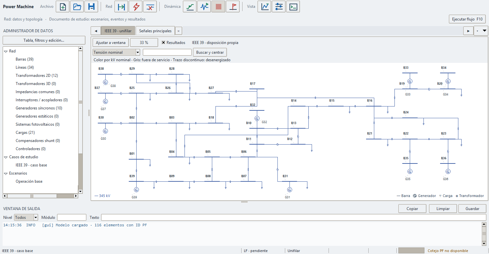
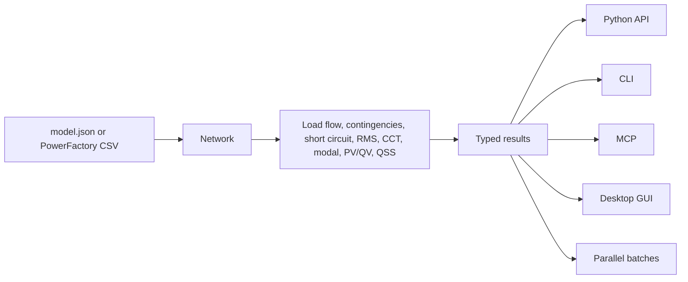

# Power Machine

> Power system studies in Python, with a desktop GUI and MCP tools for AI agents

Preliminary release **0.1.0**. [Spanish version](README.es.md).

[](https://github.com/BLITZmain2048/power_machine/actions/workflows/tests.yml)




## Highlights

AC load flow, contingency analysis, short circuit with explicit source data, classical RMS, and a desktop GUI. The default IEEE 39 network is derived from MATPOWER case39.

## Install

From a checkout, install the base package. Extras are optional.

```console
python -m pip install -e .
python -m pip install -e ".[fast]"
python -m pip install -e ".[gui]"
python -m pip install -e ".[tables]"
```

`fast` enables the optional SciPy paths, `gui` adds Matplotlib, and `tables` adds pandas. Tkinter is supplied by the Python installation on supported desktop systems.

## Ten-line IEEE 39 tour

This tour solves the base case before assessing N-1 outages. Run it from the repository root after installation.

```python
import power_machine as pm
net = pm.load_case("ieee39")
flow = pm.loadflow(net)
assert flow.status == "completed"
print(f"{flow.summary['max_mismatch_mva']:.2e}")
n1 = pm.contingency(net)
cases = n1.cases.to_records()
print(n1.status, len(cases))
worst = n1.rank().to_records()[0]
print(f"{worst['label']} {worst['max_loading_pct']:.2f}")
```

Expected output from the included case, abbreviated:

```text
2.18e-10
partial 56
L21-22 157.72
```

The [API guide](docs/api.md) explains typed result tables and diagnostics. The included example scripts cover load flow, short circuit, contingencies, RMS, and import.

## How it works



## CLI and MCP

```console
power-machine doctor
power-machine lf ieee39 --json
```

Use `power-machine-mcp` for stdio MCP. [MCP setup](docs/mcp.md) includes MCP clients configurations, tool schemas, resources, prompts, and pagination.

Short MCP transcript from the included N-1 tour:

```text
client  load_case {"name_or_path":"ieee39"}
server  network_id: "885bb4f577234a42b605ef5ad1519410", buses: 39, branches: 46
client  run_loadflow {"network_id":"885bb4f577234a42b605ef5ad1519410"}
server  result_id: "eef60159e4514317b514ee9ca76d3af4", status: completed, complete: true
client  run_contingency {"network_id":"885bb4f577234a42b605ef5ad1519410","criterion":"N-1","max_cases":100}
server  result_id: "f461d26b39394adfa96378dbba11a63f", status: partial, evaluated: 56
client  copy_network {"network_id":"885bb4f577234a42b605ef5ad1519410","label":"alternative"}
server  network_id: "32fa3e9fd0b04683ac6e0aa4c0dc0d68"
client  run_loadflow {"network_id":"32fa3e9fd0b04683ac6e0aa4c0dc0d68"}
server  result_id: "4c46901a3f9c452e9c7cda7262922346", status: completed, complete: true
client  compare_results {"before_result_id":"eef60159e4514317b514ee9ca76d3af4","after_result_id":"4c46901a3f9c452e9c7cda7262922346"}
server  before_status: completed, after_status: completed
```

## Desktop GUI

The desktop application keeps the network, study document, and stale results visibly separate. It offers load flow, contingency ranking, short-circuit input, RMS workflows, and batch controls where the study profile permits them.

## Parallel batches

Independent load-flow and contingency scenarios can run through a persistent spawned worker pool. Inputs, seeds, checkpoints, cancellation, and per-scenario failures are explicit. A worker prepares its own model snapshot and limits BLAS threads. See [batch campaigns](docs/batch.md) for the reproducible API and CLI manifest.

## Capabilities

| Study or interface | Current status | Scope |
| --- | --- | --- |
| AC load flow | Implemented | Typed tables, island diagnostics, dense path and optional sparse path |
| N-1 and N-2 | Implemented | Explicit outages, declared island-reference policy, incomplete coverage remains visible |
| Short circuit | Partial | Explicit source data and defined profiles only |
| RMS, CCT, QSS | Partial | Profiles and dynamic data are required, with separate native and classical scopes |
| PV, QV, sensitivities | Implemented | Explicit study inputs are required |
| CSV import | Partial | Imports documented export fields only, never inferred electrical data |
| GUI, CLI, MCP, batches | Implemented | GUI remains Spanish in this release |

## Performance measurements

Clean measurements on 18 November 2026 used Python 3.10.6, NumPy 2.2.6, one BLAS thread, and five samples after a CPU-idle check below 15%.

Absolute examples on that configuration are the complete IEEE 39 N-1 campaign in 170.59 ms and the 39-bus short-circuit sweep in 26.66 ms.

| Workload | Median |
| --- | ---: |
| IEEE 39 warm load flow | 2.76 ms |
| IEEE 39 N-1, `none` reference policy | 170.59 ms |
| IEEE 39 39-bus short-circuit sweep | 26.66 ms |
| Synthetic 200, 1,000, 2,000-bus load flow | 21.77 ms, 645.81 ms, 3.91 s |

### Linux SciPy measurements

[Linux benchmark samples](docs/benchmarks/linux_2026-11-18.json) were recorded with `python benchmarks/run_benchmarks.py --study all --backend both --repeats 5` on Linux x86_64, Intel Xeon at 2.10 GHz, 2 vCPU, Python 3.13.18, NumPy 2.5.3, and SciPy 1.18.1. The benchmark records one warm-up outside five samples and excludes preparation and compilation time.

| Workload | Dense | Sparse |
| --- | ---: | ---: |
| IEEE 39 load flow | 3.1 ms | 6.9 ms |
| IEEE 39 N-1 | 0.154 s | 0.177 s |
| IEEE 39 39-bus short-circuit sweep | 19.1 ms | 19.6 ms |
| Synthetic 200 / 1,000 / 2,000 / 5,000 / 10,000-bus load flow | 20.6 ms / 0.690 s / 4.010 s / not measured / not measured | 17.2 ms / 0.067 s / 0.125 s / 0.323 s / 0.618 s |

All completed load-flow runs converged. The 5,000- and 10,000-bus sparse runs used three iterations. These are separate machine measurements and are not compared with the Windows values above.

[Performance](docs/performance.md) records the protocol and measurements.

## Limits

- Imported CSV data must contain the electrical, sequence, control, and dynamic information required by the requested study. Missing data remains missing.
- Short circuit, RMS, and CCT are limited to their declared source data and profiles.
- N-1 ranking reports calculated constraints and topology outcomes. It does not establish operating feasibility, protection coordination, frequency response, or reserves.
- Performance values are measurements for the stated configuration and are not comparisons with another product.

PowerFactory is a trademark of its owner. This project is not affiliated with or endorsed by that owner.

## Repository layout

- `power_machine/` — package, public API, CLI, MCP server, GUI, and the included IEEE 39 case
- `docs/` — English usage, format, evidence, and performance documentation
- `examples/` — runnable Python examples
- `tests/` — pytest suite
- `validation/` — reproducible IEEE 39 evidence command and versioned tolerances

## Tests and contribution

Run `python -m pytest -m "not gui"` for the non-GUI suite and `python -m validation` for the included IEEE 39 evidence command. GUI tests require an available graphical Tk session. Read [CONTRIBUTING.md](CONTRIBUTING.md) before opening a contribution, especially the evidence and data-provenance requirements.

## License, data notice, and citation

The source code is MIT licensed. IEEE 39 case data  have separate provenance and terms described in [NOTICE](NOTICE). They are not covered by the code license. Cite the software using [CITATION.cff](CITATION.cff).


Includes importers and comparators for user-supplied PowerFactory exports; no PowerFactory data or results are distributed. Set `POWER_MACHINE_PF_IEEE39` to your export directory. Dependent features report `pf_reference_data_not_included` when data is absent.
