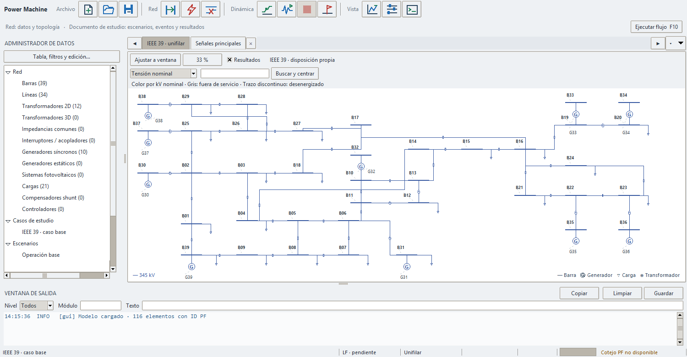
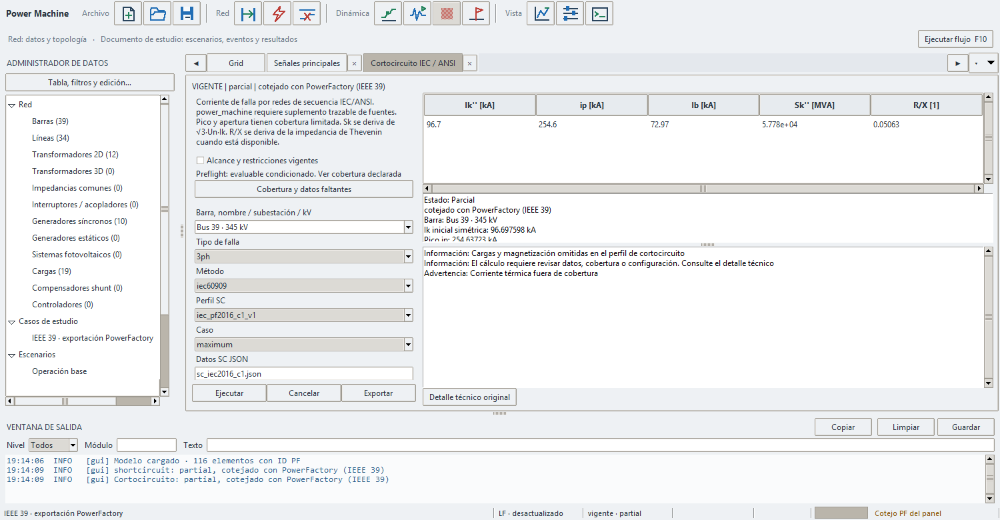
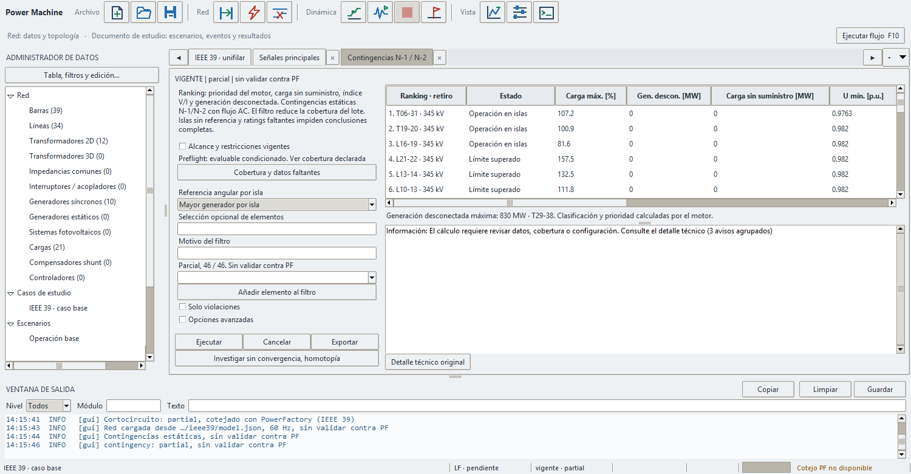
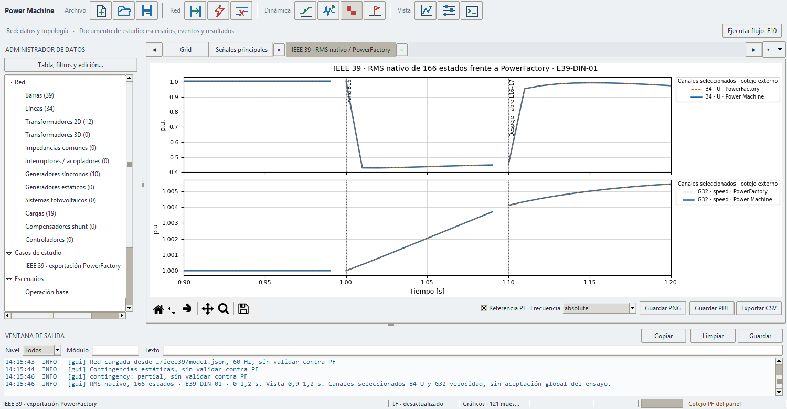

# Desktop GUI

Start the Spanish-language desktop interface with `power-machine gui ieee39`. It distinguishes a network, a study document, and stale results after an edit. The same in-memory model powers its editors and calculation panels.

The [five-action GIF](images/recorrido.gif) is recorded from the application.

## Workflow

Open a case or documented CSV export, inspect and edit the network, create or select a study document, review preflight information, run the eligible study, and save output to an explicit user destination. An edit invalidates the display of prior results while preserving their history.

The short-circuit panel requires declared source data and profile. RMS requires the corresponding dynamic profile. The N-1 view ranks calculated outcomes and keeps islanded operation, disconnected generation, and unsupplied load distinct.

The native RMS screenshot compares IEEE 39 E39-DIN-01 data for B4 voltage and G32 speed over 0.9–1.2 s. Those two displayed channels meet their stated criteria. The project-wide native RMS evidence remains partial, as described in [validation.md](validation.md).

Tk availability depends on the local desktop session. If startup fails, verify that Python includes Tcl/Tk and retry from an interactive graphical session.
