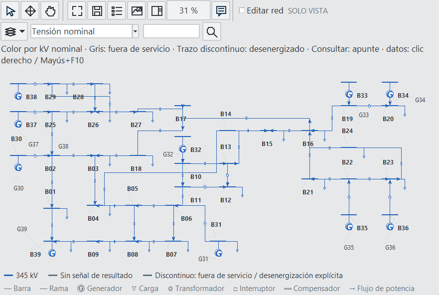

# Desktop GUI

Start the Spanish-language desktop interface with `power-machine gui ieee39`. It distinguishes a network, a study document, and stale results after an edit. The same in-memory model powers its editors and calculation panels.

## Workflow

Open a case or documented CSV export, inspect and edit the network, create or select a study document, review preflight information, run the eligible study, and save output to an explicit user destination. An edit invalidates the display of prior results while preserving their history.

The short-circuit panel requires declared source data and profile. RMS requires the corresponding dynamic profile. The N-1 view ranks calculated outcomes and keeps islanded operation, disconnected generation, and unsupplied load distinct.

Tk availability depends on the local desktop session. If startup fails, verify that Python includes Tcl/Tk and retry from an interactive graphical session.

The importers accept user-supplied CSV element-table exports. Comparisons use external references supplied by the user. External reference data and results are not distributed. Set `POWER_MACHINE_REF_IEEE39` to your export directory. Dependent features report `reference_data_not_included` when data is absent.
